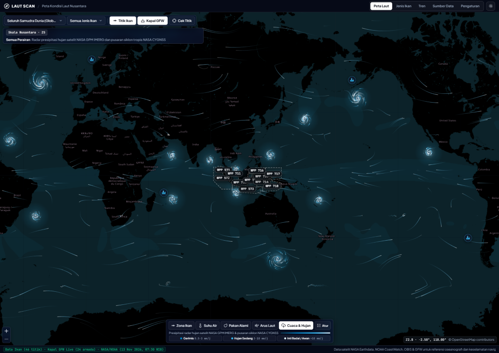
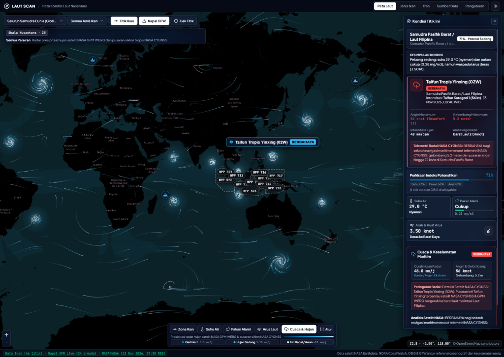
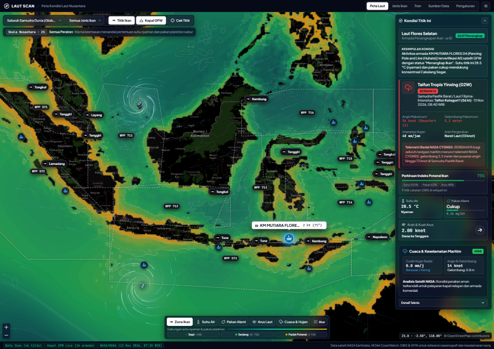
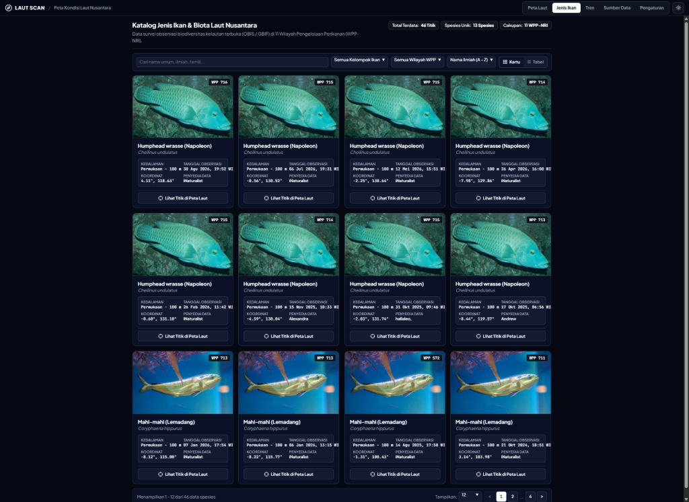

# LAUT SCAN

**Know the Ocean. Find the Fish.**

LAUT SCAN is an open-source, web-based marine intelligence and oceanographic platform covering Indonesian waters and the global ocean. It synthesizes near-real-time satellite telemetry, the official Republic of Indonesia Fisheries Management Areas (**WPP-NRI 571 through 718**), real-time global fishing vessel tracking via **Global Fishing Watch (GFW AIS)**, **NASA** cyclonic vortex & precipitation telemetry (**NASA CYGNSS & NASA GPM IMERG**), and marine biodiversity records from **OBIS / GBIF**.

---

## 🌐 Live Deployment

The latest version of LAUT SCAN is live and publicly accessible:

👉 **[https://lautscan.pages.dev/](https://lautscan.pages.dev/)**

- **Hosting Infrastructure**: Cloudflare Pages + Edge Worker runtime (`_worker.js`).
- **Compatibility**: Modern desktop and mobile browsers (Chrome, Safari, Edge, Firefox).
- **Theme Modes**: High-contrast dark *Night Maritime* (monochrome HUD) and *Daylight Maritime*.

---

## 📸 User Interface & Live Screenshots

### 1. Global Marine Map & NASA Satellite Wind Streamlines
Runge-Kutta 2nd-order (RK2) continuous wind streamline trajectories and cyclonic storm vortices in NASA cyan/ice-white monochrome palette across world oceans:



### 2. NASA CYGNSS Storm Telemetry & GPM IMERG Satellite Precipitation Radar
Marine Point Inspector showing coordinates, SST, chlorophyll-a, ocean currents, NASA IMERG precipitation radar, wave height, maximum wind speed, and maritime safety navigation status:



### 3. Real-Time Fishing Fleet Tracking (Global Fishing Watch AIS)
Interactive flight-tracker style fishing vessel markers with vessel name, MMSI, flag country, gear type, speed (knots), and coordinates:



### 4. Marine Species Catalog & Underwater Photography
Comprehensive pelagic biodiversity explorer with authentic underwater photography, scientific taxonomy, ecological depth ranges, market pricing, and conservation status:



---

## Key Features

- **Interactive Global & Archipelago Ocean Map (`/`)**:
  - Powered by a custom zero-dependency Web Mercator map engine (`@lautscan/marine-map` / `web/modules/marine-map/web/index.js`).
  - **4 Core Oceanographic Lenses**:
    - **Fish Potential Zones**: Estimated pelagic habitat suitability based on thermal comfort, plankton food availability, and thermal ocean fronts.
    - **Sea Surface Temperature (SST)**: NOAA Coral Reef Watch / Geo-Polar Blended satellite SST with high-resolution thermal contours.
    - **Natural Feed (Chlorophyll-a)**: Phytoplankton chlorophyll-a concentration from NASA MODIS and VIIRS satellite sensors.
    - **Ocean Currents**: Dynamic ocean surface current vectors and particle flow simulation.
    - **Weather & Storms**: **NASA GPM IMERG** precipitation radar combined with **NASA CYGNSS** cyclonic storm vortices and planetary wind streamlines.
- **NASA-Style Global Wind & Vortex Simulation**:
  - Continuous Runge-Kutta 2nd-order (RK2) particle advection integrating 14 active global cyclonic systems (e.g. Cyclone Seed 94S, Natuna Squall Line, Typhoon Yinxing, Hurricane Kirk, Cyclone Bheki) with planetary trade winds, westerlies, and subtropical gyres.
  - Implements dynamic viewport zoom clamping (`effectiveMinZoom`) and wrap-seam clipping at the antimeridian (`±180°`) to eliminate duplicate continents and visual tear artifacts.
- **WPP-NRI Zones 571 to 718**:
  - Official boundary polygons for all 11 Indonesian Fisheries Management Areas according to *Minister of Marine Affairs and Fisheries Regulation (Permen-KP) No. 18/2014*.
  - Full-width non-truncated dropdown selector and interactive interactive hover chips.
- **Global Fishing Watch (GFW AIS) Fleet Monitoring**:
  - Live vessel markers rendered in a clean maritime flight-tracker style.
  - Detailed vessel drawer with MMSI, vessel class, gear classification, navigation speed, flag, and coordinates.
- **Maritime Point Inspector ("Inspect Point")**:
  - Click any oceanic coordinate to compute interpolated multi-source telemetry: water temperature (°C/°F), chlorophyll-a, ocean current speed & 16-point compass direction, NASA IMERG precipitation rate, wave height, navigation safety tier, and NASA CYGNSS storm tracking.
- **Species Biodiversity Explorer (`/species`)**:
  - Catalog of commercially and ecologically important marine species complete with real underwater photos, biological taxonomy, IUCN conservation status, depth distribution, market value, and OBIS occurrence points.
  - Grid card and tabular views with search, category filtering, column sorting, and pagination.
- **Oceanographic Trends & Data Sources (`/trends`, `/sources`)**:
  - Seasonal climate anomaly tracking across marine zones.
  - Transparent data health status dashboard displaying satellite feed availability and latency.

---

## Architecture & Technology Stack

| Component | Technology |
|---|---|
| **Edge Web Deployment** | Cloudflare Pages, Cloudflare Workers runtime (`_worker.js`), HTML5 Canvas 2D, SVG, Glassmorphism CSS |
| **Frontend Map Module** | Custom standalone Web Mercator Map Engine (`@lautscan/marine-map`) with dynamic compressed raster tile generator |
| **Oceanographic & Satellite Telemetry** | **NASA CYGNSS** (surface wind & cyclones), **NASA GPM IMERG** (precipitation radar), **NOAA CoastWatch / ERDDAP** (SST & currents), **OBIS & GBIF** (biodiversity), **Global Fishing Watch** (AIS fleet telemetry) |
| **Backend & Pipeline (Local / Server)** | FastAPI (Python 3.11+), Pydantic v2, PostgreSQL 16 + PostGIS 3.4 (`SRID 4326`), Redis 7, ARQ ETL worker |

---

## Repository Structure

```text
lautscan/
├── web/                  # Production Cloudflare Pages static web client & Edge Worker
│   ├── _worker.js        # Cloudflare Edge Worker API router, raster tile engine & point telemetry
│   ├── index.html        # Single-page web application (Ocean Map, Species, Trends, Data Sources)
│   ├── app.css           # Glassmorphism design system (Night & Daylight maritime modes)
│   ├── data/             # WPP-NRI zones, NASA marine weather, source registry & GFW fleet telemetry
│   └── modules/          # Standalone @lautscan/marine-map engine (Canvas 2D + SVG + RK2 advection)
├── backend/              # FastAPI application, Alembic migrations, PostGIS models, ARQ ETL workers
├── data/wpp-nri/         # WPP-NRI 571-718 GeoJSON seed datasets and KKP conversion scripts
├── docs/                 # Product requirements (PRD.md), architecture design & OpenAPI specifications
├── frontend/             # Mobile and alternative UI component contracts
└── infra/                # Docker Compose stack, local development scripts & environment configuration
```

> **Note on Security & Privacy**: Production Cloudflare deployments are strictly isolated to the `web/` directory. Internal development assets, product requirement documents (`docs/`), test suites, and backend infrastructure files are excluded from edge static hosting and are blocked with HTTP 404 guards.

---

## Getting Started

### 1. Running the Web Client (Cloudflare Pages / Local)

To test the edge client locally:

```bash
# Start local emulation with Wrangler
npx wrangler pages dev web
```

Open `http://localhost:8788` in your browser.

To deploy to Cloudflare Pages:

```bash
npx wrangler pages deploy web --project-name=lautscan --branch=main
```

### 2. Running the Backend Stack (Docker Compose)

1. Copy the environment configuration:

   ```bash
   cp infra/.env.example infra/.env
   ```

2. Launch PostgreSQL/PostGIS, Redis, the FastAPI service, and the ETL worker:

   ```bash
   docker compose -f infra/docker-compose.yml up -d --build
   ```

3. Run database migrations and seed WPP-NRI zone boundaries:

   ```bash
   docker compose -f infra/docker-compose.yml exec api alembic upgrade head
   docker compose -f infra/docker-compose.yml exec api python -m app.db_seed
   ```

4. Verify health endpoints at `http://127.0.0.1:8080/v1/health` and OpenAPI documentation at `http://127.0.0.1:8080/docs`.

---

## Data Sources & Attribution

LAUT SCAN relies on open scientific data providers:

| Data Provider | Telemetry / Layer | License & Attribution |
|---|---|---|
| **NASA CYGNSS** | Cyclone Vortices, Ocean Surface Winds, Significant Wave Heights | Public Domain / NASA Earth Science Open Data |
| **NASA GPM IMERG** | Global Satellite Precipitation Radar & Storm Convective Cores | Public Domain / NASA GSFC |
| **NOAA CoastWatch / ERDDAP** | Sea Surface Temperature (SST) & Surface Currents | Public Domain / U.S. Government Open Data |
| **Ocean Biodiversity Information System (OBIS)** | Marine Pelagic Occurrence Records | CC0 / CC-BY Data Provider Attribution |
| **Global Fishing Watch (GFW)** | Fishing Fleet Telemetry & Maritime AIS Tracking | Non-Commercial Research / GFW Attribution |
| **WPP-NRI Boundaries** | 11 Republic of Indonesia Fisheries Management Areas | *Permen-KP No. 18/PERMEN-KP/2014* |

---

## Maritime Safety Disclaimer

The data and forecasts presented by LAUT SCAN are aggregated from satellite observations and numerical ocean models for reference, scientific analysis, and research purposes. Fish habitat estimates do not guarantee catches at exact geographical points. For navigation safety and official maritime severe weather warnings, vessel masters and mariners must always adhere to authoritative notices issued by official hydrographic and meteorological authorities (**Pushidrosal**, **Basarnas**, **BMKG**, and maritime administration agencies).

---

## License

LAUT SCAN is licensed under the [MIT License](LICENSE). Third-party oceanographic, meteorological, and biodiversity datasets retain their respective provider licenses and attributions.
