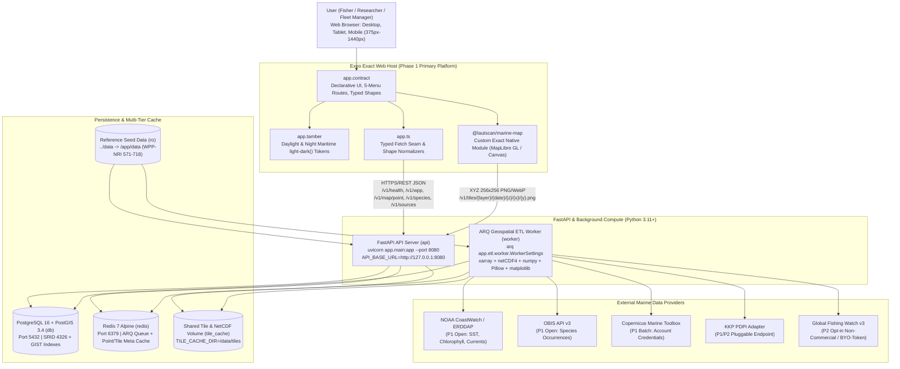
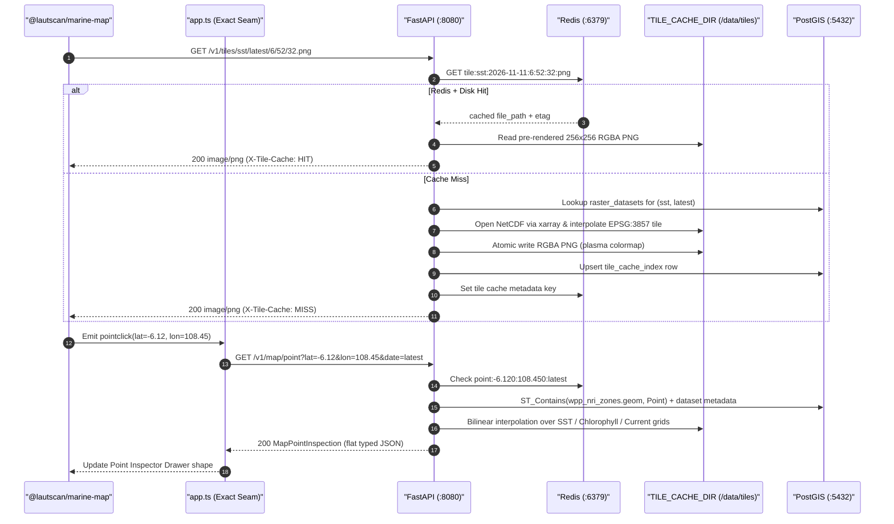
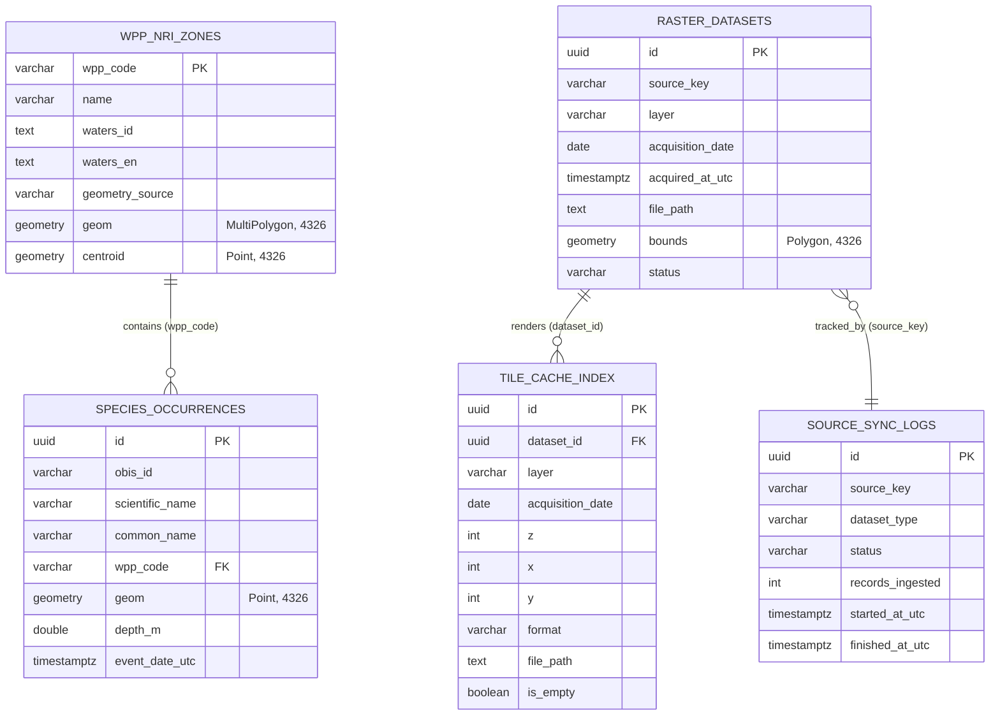

# LAUT SCAN: System Architecture & Technical Specification

**Version:** 1.2  
**Status:** Frozen Architecture Specification  
**API Contract:** [`docs/openapi-contract.yaml`](./openapi-contract.yaml) (OpenAPI 3.1.0)  
**Product Reference:** [`docs/PRD.md`](./PRD.md) (v1.2)  
**Reference Data:** [`data/wpp-nri/wpp_nri_zones.json`](../data/wpp-nri/wpp_nri_zones.json)

---

## 1. System Overview & C4 Container Architecture

LAUT SCAN separates declarative cross-platform UI (**Expo Exact**) from geospatial data ingestion, raster tiling, and spatial indexing (**FastAPI + ARQ + PostgreSQL/PostGIS + Redis**). All external API credentials (`COPERNICUS_USERNAME`, `COPERNICUS_PASSWORD`, `GFW_API_TOKEN`, `PDPI_BASE_URL`) stay strictly on the server side.



### Runtime Request & Tile Sequence



---

## 2. PostgreSQL / PostGIS Schema Design

All spatial geometries are stored in **WGS84 (`SRID 4326`)** with **GIST** spatial indexes to support fast bounding-box filters (`&&`), containment checks (`ST_Contains`), and species clustering across Indonesia (`lon 90..145`, `lat -15..10`).

### Entity-Relationship Diagram



### Canonical DDL (PostgreSQL 16 + PostGIS 3.4)

```sql
CREATE EXTENSION IF NOT EXISTS postgis;
CREATE EXTENSION IF NOT EXISTS pgcrypto;

-- 1. Indonesian Fisheries Management Areas (WPP-NRI 571-718)
CREATE TABLE wpp_nri_zones (
    wpp_code                VARCHAR(3) PRIMARY KEY
                            CHECK (wpp_code IN ('571','572','573','711','712','713','714','715','716','717','718')),
    name                    VARCHAR(32) NOT NULL,
    waters_id               TEXT NOT NULL,
    waters_en               TEXT NOT NULL,
    legal_basis             VARCHAR(64) NOT NULL DEFAULT 'Permen-KP No. 18/PERMEN-KP/2014',
    geometry_source         VARCHAR(24) NOT NULL DEFAULT 'p0_seed'
                            CHECK (geometry_source IN ('p0_seed', 'kkp_official')),
    geom                    GEOMETRY(MultiPolygon, 4326) NOT NULL,
    centroid                GEOMETRY(Point, 4326) NOT NULL,
    min_lon                 DOUBLE PRECISION NOT NULL,
    min_lat                 DOUBLE PRECISION NOT NULL,
    max_lon                 DOUBLE PRECISION NOT NULL,
    max_lat                 DOUBLE PRECISION NOT NULL,
    area_km2                DOUBLE PRECISION,
    sst_mean_c              DOUBLE PRECISION,
    chlorophyll_mean_mg_m3  DOUBLE PRECISION,
    latest_observation_utc  TIMESTAMPTZ,
    created_at              TIMESTAMPTZ NOT NULL DEFAULT NOW(),
    updated_at              TIMESTAMPTZ NOT NULL DEFAULT NOW()
);

CREATE INDEX idx_wpp_nri_zones_geom_gist
    ON wpp_nri_zones USING GIST (geom);

CREATE INDEX idx_wpp_nri_zones_centroid_gist
    ON wpp_nri_zones USING GIST (centroid);


-- 2. Ingested Satellite / Model Raster Datasets (NetCDF / Zarr metadata)
CREATE TABLE raster_datasets (
    id                      UUID PRIMARY KEY DEFAULT gen_random_uuid(),
    source_key              VARCHAR(32) NOT NULL
                            CHECK (source_key IN ('noaa_erddap','obis','copernicus_marine','kkp_pdpi','gfw')),
    layer                   VARCHAR(24) NOT NULL
                            CHECK (layer IN ('sst', 'chlorophyll', 'currents')),
    acquisition_date        DATE NOT NULL,
    acquired_at_utc         TIMESTAMPTZ NOT NULL,
    variable_name           VARCHAR(64) NOT NULL,
    units                   VARCHAR(32) NOT NULL,
    spatial_resolution_km   DOUBLE PRECISION NOT NULL,
    file_path               TEXT NOT NULL,
    bounds                  GEOMETRY(Polygon, 4326) NOT NULL,
    min_value               DOUBLE PRECISION,
    max_value               DOUBLE PRECISION,
    checksum_sha256         VARCHAR(64),
    status                  VARCHAR(16) NOT NULL DEFAULT 'ready'
                            CHECK (status IN ('pending', 'ready', 'failed', 'expired')),
    created_at              TIMESTAMPTZ NOT NULL DEFAULT NOW(),
    CONSTRAINT uq_raster_source_layer_date UNIQUE (source_key, layer, acquisition_date)
);

CREATE INDEX idx_raster_datasets_bounds_gist
    ON raster_datasets USING GIST (bounds);

CREATE INDEX idx_raster_datasets_layer_date
    ON raster_datasets (layer, acquisition_date DESC)
    WHERE status = 'ready';


-- 3. Rendered XYZ Raster Tile Cache Index
CREATE TABLE tile_cache_index (
    id                      UUID PRIMARY KEY DEFAULT gen_random_uuid(),
    dataset_id              UUID NOT NULL REFERENCES raster_datasets(id) ON DELETE CASCADE,
    layer                   VARCHAR(24) NOT NULL
                            CHECK (layer IN ('sst', 'chlorophyll', 'currents')),
    acquisition_date        DATE NOT NULL,
    z                       SMALLINT NOT NULL CHECK (z BETWEEN 0 AND 14),
    x                       INTEGER NOT NULL CHECK (x >= 0),
    y                       INTEGER NOT NULL CHECK (y >= 0),
    format                  VARCHAR(8) NOT NULL DEFAULT 'png'
                            CHECK (format IN ('png', 'webp')),
    file_path               TEXT NOT NULL,
    byte_size               INTEGER NOT NULL CHECK (byte_size >= 0),
    is_empty                BOOLEAN NOT NULL DEFAULT FALSE,
    etag                    VARCHAR(64) NOT NULL,
    hit_count               INTEGER NOT NULL DEFAULT 0,
    created_at              TIMESTAMPTZ NOT NULL DEFAULT NOW(),
    last_accessed_at        TIMESTAMPTZ NOT NULL DEFAULT NOW(),
    CONSTRAINT uq_tile_xyz UNIQUE (layer, acquisition_date, z, x, y, format)
);

CREATE INDEX idx_tile_cache_layer_date
    ON tile_cache_index (layer, acquisition_date);

CREATE INDEX idx_tile_cache_lru
    ON tile_cache_index (last_accessed_at ASC);


-- 4. Marine Species & Fish Occurrences (OBIS v3)
CREATE TABLE species_occurrences (
    id                      UUID PRIMARY KEY DEFAULT gen_random_uuid(),
    obis_id                 VARCHAR(64) UNIQUE,
    scientific_name         VARCHAR(160) NOT NULL,
    common_name             VARCHAR(160),
    taxon_rank              VARCHAR(48),
    family                  VARCHAR(96),
    wpp_code                VARCHAR(3) REFERENCES wpp_nri_zones(wpp_code) ON DELETE SET NULL,
    geom                    GEOMETRY(Point, 4326) NOT NULL,
    depth_m                 DOUBLE PRECISION,
    event_date_utc          TIMESTAMPTZ,
    individual_count        INTEGER CHECK (individual_count IS NULL OR individual_count >= 0),
    habitat_note            TEXT,
    dataset_name            TEXT,
    attribution             TEXT NOT NULL,
    license                 VARCHAR(128),
    ingested_at_utc         TIMESTAMPTZ NOT NULL DEFAULT NOW()
);

CREATE INDEX idx_species_occurrences_geom_gist
    ON species_occurrences USING GIST (geom);

CREATE INDEX idx_species_occurrences_wpp
    ON species_occurrences (wpp_code);

CREATE INDEX idx_species_occurrences_scientific_name
    ON species_occurrences (scientific_name);

CREATE INDEX idx_species_occurrences_event_date
    ON species_occurrences (event_date_utc DESC);


-- 5. External Data Provider ETL Sync Logs & Health Telemetry
CREATE TABLE source_sync_logs (
    id                      UUID PRIMARY KEY DEFAULT gen_random_uuid(),
    source_key              VARCHAR(32) NOT NULL
                            CHECK (source_key IN ('noaa_erddap','obis','copernicus_marine','kkp_pdpi','gfw')),
    dataset_type            VARCHAR(48) NOT NULL,
    status                  VARCHAR(16) NOT NULL
                            CHECK (status IN ('success', 'partial', 'failed', 'skipped')),
    records_ingested        INTEGER NOT NULL DEFAULT 0 CHECK (records_ingested >= 0),
    started_at_utc          TIMESTAMPTZ NOT NULL DEFAULT NOW(),
    finished_at_utc         TIMESTAMPTZ,
    duration_ms             INTEGER CHECK (duration_ms IS NULL OR duration_ms >= 0),
    error_message           TEXT,
    metadata_json           JSONB NOT NULL DEFAULT '{}'::jsonb
);

CREATE INDEX idx_source_sync_logs_source_started
    ON source_sync_logs (source_key, started_at_utc DESC);
```

> **Note on `wpp_nri_zones` seeding:** `data/wpp-nri/wpp_nri_zones.json` contains RFC 7946 `Polygon` features for P0 seeding. At load time, the backend normalizes geometries with `ST_Multi(ST_MakeValid(ST_SetSRID(ST_GeomFromGeoJSON(:geojson), 4326)))` so both single-polygon P0 seeds and multi-polygon official KKP shapefiles satisfy `GEOMETRY(MultiPolygon, 4326)`.

---

## 3. XYZ Raster Tile Pipeline & Point Inspection Interpolation

### 3.1 Tile Projection, Format & Caching Pipeline

- **Source Grids:** Stored locally under `TILE_CACHE_DIR` (mounted at `/data/tiles`) as CF-compliant NetCDF files in **WGS84 (`EPSG:4326`)**, clipped to Indonesia's marine domain (`lon ∈ [90.0, 145.0]`, `lat ∈ [-15.0, 10.0]`).
- **Output Tiles:** Rendered on demand (or pre-warmed for zoom levels `z ∈ [3, 7]` by the ARQ worker) in **Web Mercator (`EPSG:3857`)** at **`256×256` RGBA** (`image/png` default; `image/webp` optional via `?format=webp` for low-bandwidth maritime connections).
- **Resampling Engine (aligned with `backend/pyproject.toml`):** Implemented purely with `xarray`, `netCDF4`, `numpy`, `Pillow`, and `matplotlib` (zero extra native rasterio overhead):
  1. Convert Slippy Map `(z, x, y)` tile indices to Web Mercator pixel center coordinates `(X_m, Y_m)` across a `256×256` grid.
  2. Inverse-project `(X_m, Y_m)` analytically to WGS84 `(lon, lat)`:
     - `lon = (x_norm * 360.0) - 180.0`
     - `lat = degrees(atan(sinh(pi * (1.0 - 2.0 * y_norm))))`
  3. Sample the `xarray.Dataset` via bilinear interpolation (`numpy` index interpolation over uniform `lat/lon` axes).
  4. Mask `NaN`, land pixels, cloud-flagged cells, and values outside Indonesia bounds with **`alpha = 0`** (fully transparent).
  5. Map normalized scalar values `[0.0, 1.0]` through a 256-entry RGBA lookup table (`matplotlib.colormaps`) and encode to `256×256` RGBA PNG/WebP via `Pillow`.
  6. Write atomically to `TILE_CACHE_DIR/{layer}/{date}/{z}/{x}/{y}.{fmt}`, upsert `tile_cache_index`, and cache metadata in Redis (`tile:{layer}:{date}:{z}:{x}:{y}:{fmt}`, TTL 3600s).

### 3.2 Colorblind-Safe Colormaps & Ocean Currents Vector/Grid Spec

In compliance with PRD Section 8.2, **rainbow / jet colormaps are strictly prohibited**.

| Layer Key | Physical Quantity | Scale & Domain | Colormap / Representation | Legend Labels |
|---|---|---|---|---|
| `sst` | Sea Surface Temperature | Linear `20.0°C to 34.0°C` | `matplotlib` **`plasma`** (perceptually uniform, colorblind-safe) | Min/Mid/Max `°C` (or `°F`) + numeric ticks |
| `chlorophyll` | Chlorophyll-a Concentration | Log10 `0.01 to 10.0 mg/m³` | `matplotlib` **`viridis`** (perceptually uniform, colorblind-safe) | `0.01`, `0.1`, `1.0`, `10.0 mg/m³` |
| `currents` (Tile) | Ocean Current Speed Magnitude `√(u² + v²)` | Linear `0.0 to 2.5 m/s` | `matplotlib` **`cividis`** (CVD-safe sequential speed field) via `/v1/tiles/currents/{date}/{z}/{x}/{y}.png` | `0.0 to 2.5 m/s` (`0.0 to 4.9 kn`) |
| `currents` (Vector/Grid JSON) | Surface Velocity Field `(u_ms, v_ms)` | Decimated grid step (e.g. `0.25°` to `1.0°` by zoom) | **Vector/Grid JSON** payload for `@lautscan/marine-map` directional arrow canvas overlay (P2 extension `/v1/currents/grid`) | Arrow bearing + speed scale bar |

**Vector/Grid JSON Specification (Ocean Currents Arrows):**  
When rendering directional arrows in `@lautscan/marine-map`, the worker/API decimates eastward (`u_ms`) and northward (`v_ms`) NetCDF components over the viewport `bbox` at zoom-dependent stride so payloads remain `< 40 KB` on mobile connections:
- Scalar metrics per cell: `lat`, `lon`, `u_ms`, `v_ms`, `speed_ms = sqrt(u^2 + v^2)`, `direction_deg = (atan2(u, v) * 180 / pi + 360) % 360` (oceanographic *flowing-to* bearing).
- While the core OpenAPI contract freezes the 6 core endpoints (`health`, `wpp`, `tiles`, `map/point`, `species`, `sources`), `currents` speed tiles serve immediately on `/v1/tiles/currents/{date}/{z}/{x}/{y}.png` and point-level vector values (`current_speed_ms`, `current_speed_knots`, `current_direction_deg`, `current_compass`) serve via `/v1/map/point`.

### 3.3 Point Inspection Interpolation Query (`GET /v1/map/point`)

When a user clicks or taps `(lat, lon)` on the map (`pointclick`), FastAPI executes:

1. **Redis Lookup:** Check `point:{round(lat, 3)}:{round(lon, 3)}:{date}` (TTL 1800s).
2. **PostGIS Zone Containment (GIST-indexed):**
   ```sql
   SELECT wpp_code, name, waters_id
   FROM wpp_nri_zones
   WHERE ST_Contains(
       geom,
       ST_SetSRID(ST_Point(:lon, :lat), 4326)
   )
   LIMIT 1;
   ```
3. **Raster Grid Bilinear Interpolation:**
   - Resolve the latest `ready` row in `raster_datasets` for `acquisition_date <= target_date` (setting `is_cached_fallback = true` if falling back to an older cached date because the latest ETL run failed or is pending).
   - Run `ds[var].interp(lat=lat, lon=lon, method="linear")` across `sst`, `chlorophyll`, and `currents` `(u, v)`.
   - **Coastal Pixel Fallback:** If bilinear interpolation hits `NaN` due to an adjacent land mask cell, fall back to `method="nearest"` within `<= 1` grid cell (`max_delta_deg`) and record `interpolation_method = "nearest"` (or `"unavailable"` if entirely over land/outside coverage).
   - Compute derived telemetry fields (`sst_f = sst_c * 9/5 + 32`, `current_speed_knots = current_speed_ms * 1.94384`, 16-point `current_compass`) and return a flat `MapPointInspection` JSON record with satellite `acquired_at_utc`, `spatial_resolution_km`, `attribution`, and disclaimer.

---

## 4. Expo Exact Contract <-> FastAPI Integration Pattern

Expo Exact separates declarative UI (`app.contract`), theme tokens (`app.tamber`), and data/network logic (`app.ts`). Because Exact validates every resource and mutation response strictly against declared `shape` schemas (rejecting unexpected fields, untyped dictionaries, and heterogeneous arrays), [`docs/openapi-contract.yaml`](./openapi-contract.yaml) enforces **flat typed records** across all JSON responses.

### 4.1 Frontend Module Structure

```text
frontend/
├── app.contract                 # 5-menu routes, state, resources, actions, strict shapes
├── app.tamber                   # Daylight & Night Maritime CSS light-dark() design tokens
├── app.ts                       # Typed FastAPI fetch seam (API_BASE_URL) + Option adapters
└── modules/
    └── marine-map/              # Custom Exact Native Module (@lautscan/marine-map)
        ├── web/                 # MapLibre GL JS / Canvas 2D wrapper (OSM + XYZ + WPP + arrows)
        └── contract.ts          # Props & events bridge (pointclick, moveend, wppselect)
```

### 4.2 OpenAPI Schemas <-> Exact Contract `shape` Definitions

Every JSON schema in `docs/openapi-contract.yaml` maps 1:1 with identical field names to an Exact Contract closed `shape` (`number`, `string`, `bool`, `option<T>`, `T[]`). In `app.ts`, OpenAPI nullable scalar fields (`type: ["number", "null"]`, `type: ["string", "null"]`, `type: ["integer", "null"]`) are converted directly to Exact `none` / `some(x)` (`option<T>`), keeping field names identical across OpenAPI and Contract with zero extra fields:

```contract
shape HealthStatus
  status: string
  service: string
  version: string
  environment: string
  db_ok: bool
  postgis_version: option<string>
  redis_ok: bool
  tile_cache_ok: bool
  timestamp_utc: string

shape WppZoneRecord
  wpp_code: string
  name: string
  waters_id: string
  waters_en: string
  legal_basis: string
  geometry_source: string
  centroid_lat: number
  centroid_lon: number
  min_lon: number
  min_lat: number
  max_lon: number
  max_lat: number
  area_km2: option<number>
  sst_mean_c: option<number>
  chlorophyll_mean_mg_m3: option<number>
  latest_observation_utc: option<string>
  geometry_geojson: option<string>

shape WppZoneListResponse
  items: WppZoneRecord[]
  total: number

shape MapPointInspection
  lat: number
  lon: number
  requested_date: string
  resolved_date: option<string>
  wpp_code: option<string>
  wpp_name: option<string>
  wpp_waters_id: option<string>
  sst_c: option<number>
  sst_f: option<number>
  chlorophyll_mg_m3: option<number>
  current_speed_ms: option<number>
  current_speed_knots: option<number>
  current_direction_deg: option<number>
  current_compass: option<string>
  salinity_psu: option<number>
  wave_height_m: option<number>
  interpolation_method: string
  spatial_resolution_km: option<number>
  primary_source: option<string>
  attribution: string
  acquired_at_utc: option<string>
  is_cached_fallback: bool
  disclaimer: string

shape SpeciesOccurrenceRecord
  id: string
  obis_id: option<string>
  scientific_name: string
  common_name: option<string>
  taxon_rank: option<string>
  family: option<string>
  lat: number
  lon: number
  wpp_code: option<string>
  depth_m: option<number>
  event_date_utc: option<string>
  individual_count: option<number>
  habitat_note: option<string>
  dataset_name: option<string>
  attribution: string
  license: option<string>

shape SpeciesOccurrenceListResponse
  items: SpeciesOccurrenceRecord[]
  total: number
  limit: number
  offset: number
  has_more: bool

shape DataSourceStatusRecord
  source_key: string
  display_name: string
  priority: string
  enabled: bool
  requires_credentials: bool
  non_commercial_only: bool
  status: string
  last_sync_utc: option<string>
  latest_data_timestamp_utc: option<string>
  last_error: option<string>
  attribution: string
  license_summary: string
  official_url: string

shape SourceSyncLogRecord
  id: string
  source_key: string
  dataset_type: string
  status: string
  records_ingested: number
  started_at_utc: string
  finished_at_utc: option<string>
  duration_ms: option<number>
  error_message: option<string>

shape DataSourcesResponse
  sources: DataSourceStatusRecord[]
  recent_logs: SourceSyncLogRecord[]
  checked_at_utc: string

shape ErrorResponse
  error_code: string
  message: string
  detail: option<string>
  timestamp_utc: string
```

> **Design Note:** Notice how `WppZoneRecord` encodes `geometry_geojson` as a JSON-serialized `string` (not a nested polymorphic GeoJSON `Polygon`/`MultiPolygon` coordinate array). This guarantees Exact Contract `shape` compatibility while allowing `@lautscan/marine-map` to parse `JSON.parse(zone.geometry_geojson)` directly into MapLibre vector sources, and allows low-bandwidth table views to pass `?include_geometry=false`.

### 4.3 `app.tamber` Design Tokens (`light-dark()`) & Maritime Accessibility

Visual tokens follow PRD Section 8.2 using CSS `light-dark(daylight, night)` for **Daylight Maritime** (glare-resistant light mode at sea) and **Night Maritime** (OLED-friendly low-emission bridge mode):

```css
/* app.tamber: LAUT SCAN Maritime Dual Theme Tokens */
:root {
  color-scheme: light dark;

  --surface-canvas:   light-dark(#F8FAFC, #0A0E27);
  --surface-elevated: light-dark(#FFFFFF, #0D1117);
  --ink-primary:      light-dark(#1E293B, #E6EDF3);
  --ink-muted:        light-dark(#475569, #94A3B8);
  --border-subtle:    light-dark(#E2E8F0, #30363D);
  --accent-primary:   light-dark(#3B82F6, #60A5FA);
  --accent-cta:       light-dark(#F97316, #F97316);
  --status-healthy:   light-dark(#16A34A, #22C55E);
  --status-degraded:  light-dark(#D97706, #F59E0B);
  --status-error:     light-dark(#DC2626, #EF4444);

  --font-sans: "Fira Sans", system-ui, -apple-system, sans-serif;
  --font-mono: "Fira Code", ui-monospace, monospace;
  --touch-target-min: 44px;
}
```

**UI/UX Compliance Rules Enforced Across Views:**
- **Typography:** `Fira Sans` (`>= 16px` body on mobile) for labels/navigation; `Fira Code` with `font-variant-numeric: tabular-nums` for coordinates, depths, SST/Chlorophyll metrics, and UTC/WIB/WITA/WIT timestamps.
- **Icons & Interactions:** Lucide SVG icons only (**zero emoji UI icons**), `cursor: pointer` on clickable map controls/cards, `>= 44×44px` minimum touch targets, visible `:focus-visible` rings, `150-300ms` transitions respecting `@media (prefers-reduced-motion: reduce)`, and WCAG AA (`>= 4.5:1`) contrast in both modes.
- **Low-Bandwidth Accessibility:** Every map/chart view provides an accessible summary table fallback (`GET /v1/wpp?include_geometry=false`).

### 4.4 5-Menu `routes` Mapping (Map-Centric Navigation)

```contract
routes
  tab ocean_map "/"
  tab species   "/species"
  tab trends    "/trends"
  tab sources   "/sources"
  tab settings  "/settings"
```

| Menu Label | Route | Primary API Endpoints | Screen Responsibilities |
|---|---|---|---|
| **Ocean Map** *(Default)* | `/` | `/v1/wpp`, `/v1/tiles/{layer}/{date}/{z}/{x}/{y}.png`, `/v1/map/point`, `/v1/species` | Full-bleed (`>=75%`) interactive workspace via `@lautscan/marine-map`, floating layer opacity toggles, colorblind-safe numeric legends, WPP-NRI filter, date selector, permanent attribution/freshness badge, and Point Inspector Drawer. |
| **Species** | `/species` | `/v1/species`, `/v1/wpp` | Taxonomic & WPP-NRI search of OBIS biodiversity observations, binomial & common names, depth/habitat summaries, and synchronized distribution pins. |
| **Trends** | `/trends` | `/v1/wpp`, `/v1/map/point` | Historical SST & Chlorophyll-a time-series, monsoon seasonal comparison, and map date/time-slider synchronization. |
| **Overview & Sources** | `/sources` | `/v1/sources`, `/v1/health`, `/v1/wpp?include_geometry=false` | Accessible WPP-NRI summary table, provider ingestion health (`noaa_erddap`, `obis`, `copernicus_marine`, `kkp_pdpi`, `gfw`), sync logs, and open-data attribution/licenses. |
| **Settings** | `/settings` | `/v1/health` | Unit preferences (`°C`/`°F`, `knot`/`m/s`), theme mode (**Daylight Maritime** / **Night Maritime**), offline tile/summary cache controls, and GFW non-commercial compliance disclosure. |

### 4.5 Custom Native Module `@lautscan/marine-map` Contract Boundary

Standard `@exact/maps` only supports a single XYZ base tile layer and simple marker pins. `@lautscan/marine-map` bridges that gap without breaking Exact's Contract boundary:

- **Props in:** `centerLat`, `centerLon`, `zoom`, `baseStyle` (OSM / dark maritime tiles), `sstVisible`, `sstOpacity`, `chlorophyllVisible`, `chlorophyllOpacity`, `currentsVisible`, `currentsOpacity`, `selectedDate`, `wppGeoJsonCollection`, `selectedWppCode`, `speciesMarkers`.
- **Events out:**
  - `pointclick(lat: number, lon: number)` -> triggers `GET /v1/map/point` and opens Point Inspector Drawer.
  - `moveend(minLon: number, minLat: number, maxLon: number, maxLat: number, zoom: number)` -> debounced (`300ms`) viewport bbox query for `/v1/species`.
  - `wppselect(wppCode: string)` -> filters & zooms map bounds to selected WPP-NRI zone.
- **Host Implementations:**
  - **Phase 1 (Web Host):** MapLibre GL JS (WebGL raster + GeoJSON fill/line + Canvas vector arrow layer) mounted inside an Exact custom native element.
  - **Phase 2 (Apple Host):** Native `MKMapView` / `MKTileOverlay` / `MKPolygon` adapter exposing the identical Contract event/prop surface.

---

## 5. Infrastructure, Ports & Security Alignment

Aligned directly with [`infra/docker-compose.yml`](../infra/docker-compose.yml) and [`infra/.env.example`](../infra/.env.example):

| Service | Image / Runtime | Port | Key Environment Variables | Role |
|---|---|---|---|---|
| `db` | `postgis/postgis:16-3.4` | `5432` | `POSTGRES_DB`, `POSTGRES_USER`, `POSTGRES_PASSWORD`, `DATABASE_URL` | Spatial persistence (`SRID 4326`, GIST) |
| `redis` | `redis:7-alpine` | `6379` | `REDIS_HOST`, `REDIS_PORT`, `REDIS_URL` | ARQ broker + point/tile metadata cache |
| `api` | Python 3.11+ (`uvicorn app.main:app --port 8080`) | `8080` | `API_BASE_URL=http://127.0.0.1:8080`, `TILE_CACHE_DIR=/data/tiles` | OpenAPI 3.1.0 REST & XYZ tile serving |
| `worker` | Python 3.11+ (`arq app.etl.worker.WorkerSettings`) | N/A | `NOAA_ERDDAP_BASE_URL`, `OBIS_API_BASE_URL`, `COPERNICUS_*`, `PDPI_BASE_URL`, `GFW_API_TOKEN` | Scheduled ETL, NetCDF download, tile pre-render |

### Security & License Compliance Boundaries

- **Credential Isolation:** `COPERNICUS_USERNAME`, `COPERNICUS_PASSWORD`, `PDPI_BASE_URL`, and `GFW_API_TOKEN` exist solely in backend `.env` / environment configuration and are never forwarded in API responses or frontend bundles.
- **GFW Non-Commercial Boundary:** `GFW_API_TOKEN` is opt-in and disabled by default (`status = "disabled"` or `"unconfigured"` in `/v1/sources`). Free-tier Global Fishing Watch tokens are restricted to non-commercial / public-interest use; commercial deployments must supply an independent licensed BYO-Token to preserve LAUT SCAN's MIT license.
- **Disclaimer Requirement:** `/v1/map/point` and the UI permanent badge surface acquisition timestamps, spatial resolution, source attribution, and the explicit notice that satellite/historical data are not real-time fish location guarantees and do not substitute official navigation safety advisories (BMKG / Pushidrosal / Basarnas).
